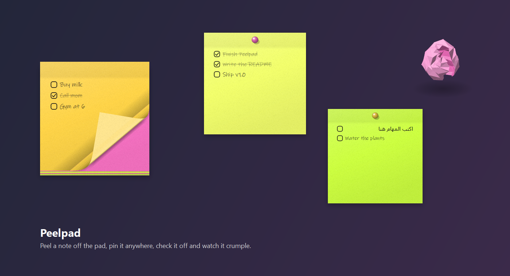

# Peelpad

Sticky notes for Windows that feel like paper. Write your tasks on a pad of neon
sticky notes, peel the top sheet off with your mouse and drop it anywhere on
your screen. It stays pinned on top of your other windows. When you've checked
off every task, the note crumples into a ball and disappears.



## What it does

- **A pad you peel from.** Write on the top sheet, then grab the paper and pull.
  It curls back over a little roll, showing its paler back, and the curl
  travels across the whole sheet as you pull, until it comes off. Carried
  around, it swings and ripples with the air. Let go before it tears and it
  springs back onto the pad.
- **Pinned anywhere, any size.** A torn-off note lands where you drop it and
  stays on top of every app. You can have as many as you like. Pick one up by
  its paper and it swings like a sheet from the pad, or double-click it (the pad too): it
  follows your mouse with no button held and lands where you click. To resize it, press ↕
  under it, drag the handles (Shift keeps its shape) and press ✓. Or hold Ctrl
  and turn the mouse wheel over it. Ctrl + wheel over the pad changes the size
  of its sheets.
- **Wind.** Pinned notes sway in a gusty breeze, glued along their top: the free
  part lifts toward you, ripples and flaps. Move the mouse onto a note and it
  holds still so you can write. Turn it off or set its speed (up to 7.2 m/s) in
  Settings → General.
- **Tasks and text.** Every row has a check box. Right-click the box to make the
  row a plain line instead. Arabic and other right-to-left text works.
- **Crumple when done.** Check off the last task and the note scrunches into a
  ball (a 3D paper mesh with real shading), then pops away. ✓ finishes a note by
  hand, ✕ throws it away.
- **Stats.** Settings → Stats shows the days you wrote notes, the days you checked
  off everything you wrote, your current and best streak, notes finished, tasks
  checked, and a heat map of the last 18 weeks.
- **History.** Settings → History is a calendar: each day shows how many tasks
  you checked off. Click a day to see what you checked off and what you wrote.
  Tick tasks to delete them, delete a whole day, or delete everything (notes
  still pinned on your desktop stay).
- **Looks.** The default is four neon sticky-note colours (lemon, mango,
  bubblegum, lime), a new one for each sheet. Or pick one colour, or a theme:
  Midnight (black paper, glowing blue ink), Neon night (glowing pink), Toxic
  (glowing green), Paper white, Kraft. Or choose your own paper and ink colours,
  or design your own skin (see below).
- **Writing.** Pick any font (the default is handwriting), the text size, any
  ink colour, and an effect: Solid, Gradient, Neon (shines like a sign), Toon
  (cartoon outline), Pop (bold offset shadow), Gummy (candy shine) or Prism
  (rainbow). Arabic is written in [Aref Ruqaa](https://github.com/alif-type/aref-ruqaa),
  a Ruqʿah font that looks written with a pen (SIL Open Font License, included).
- **Your language.** English, العربية, Español, 日本語 and 中文. Peelpad follows
  your Windows language, or pick one in Settings → General. In Arabic the
  windows read right to left.

## Your own skin

Settings → Look → **Upload your own skin…** Every note and the pad switch to it at once.

| | |
|---|---|
| Size | **600 × 600 px.** Other sizes work too: notes keep your picture's shape. 300 px and up stays sharp. |
| Format | **PNG.** Transparent pixels are see-through on your desktop, and clicks go through them, so a skin can be any shape: a ghost, a cat, a torn page. JPG and WebP work too, without transparency. |
| Glue band | The top **96 px**. The pin sits there, and that's where you grab a pinned note. Decorate it freely. |
| Safe text area | **480 × 444 px**: 60 px in from the left, right and bottom, 96 px down from the top. Tasks are written here, so keep it calm enough to read on. |
| Ink | Picked for you: dark ink on light pictures, light ink on dark ones. You can also choose any colour, with or without the neon glow, in Settings → Writing. |

**Any shape.** The note takes the shape of your picture: a frame with skulls
peeking over the edge, a circle, a cat. Peelpad finds the calm middle of the
picture and writes there; move or resize that text box yourself in Settings →
Look → Text box. Many "transparent" PNGs from the web have the grey-and-white
checkerboard painted in. Peelpad spots that and makes it truly see-through.

**Save the template PNG…** gives you a 600 × 600 guide with the glue band and safe
area marked. Paint over it in any editor, then upload it.

**Animated skins.** Upload an animated GIF, APNG or WebP and it plays on every
note, looping. Peelpad comes with nine, drawn in code so they stay sharp at
any size, and the writing in the middle never moves:

- *Weather (live)*: the sky over your city, changing by itself: sun, soft 3D
  clouds, rain, snow, thunderstorms with lightning, fog, or the moon and stars
  at night. Type your city in Settings → Look (you can also preview each weather)
- *Retro LED clock*: seven-segment date and time in the colour you pick, a ring
  of LEDs that fills every minute and a pixel bar that grows each minute of the hour
- *Arcade*: a little yellow chomper runs round a neon maze eating the dots,
  the score ticking up; the dots come back every lap
- *Skull parade*: a little skull runs along the bottom, a bat flaps, stars twinkle
- *Apple worm*: a worm crawls round a black frame eating the apples (they grow back)
- *Aquarium*: two fish swim round a frosted card, bubbles rise, seaweed sways
- *Night sky*: twinkling stars, a glowing moon, a shooting star now and then, drifting clouds
- *Rainy window*: drops run down the glass while a cat sleeps on the sill
- *Synthwave*: a striped sun sets behind palms over an endless neon grid

Settings → Look → **Copy a prompt for an animated skin** gives you a ready
brief to paste into an AI animation tool (or send to an artist). It is also in
[docs/animated-skin-prompt.md](docs/animated-skin-prompt.md).

## Keys

| | |
|---|---|
| Enter | new task below |
| Backspace on an empty row | remove it |
| ↑ ↓ | move between rows |
| Ctrl+Enter | peel the sheet off for you and drop it beside the pad |
| Right-click a check box | plain line ↔ task |
| Right-click the pad | settings, keep the pad on top, hide, quit |

– minimises the pad to the taskbar. Peelpad also lives in the tray with your
pinned notes; right-click the tray icon to quit.

## Install

Download `Peelpad-Setup-<version>.exe` from
[Releases](https://github.com/Niro54321/Peelpad/releases) and run it. It installs
for your user only (no admin prompt). The installer isn't code-signed yet, so
Windows SmartScreen may warn you: choose **More info → Run anyway**.

## Run from source

Needs Python 3.10+ on Windows 10 or 11.

```bash
python -m venv .venv
.venv\Scripts\pip install -r requirements.txt
.venv\Scripts\python -m peelpad
```

Tests:

```bash
.venv\Scripts\python -m pytest tests -q
```

Build the installer (needs `pip install pyinstaller` and Inno Setup 6):

```bash
.venv\Scripts\python packaging\build.py
```

Build the Microsoft Store package (MSIX, signed by the Store when you submit it).
It needs `makeappx.exe` from Microsoft's
[Windows SDK build tools](https://www.nuget.org/packages/Microsoft.Windows.SDK.BuildTools)
unpacked under `build\sdk`, and your Partner Center identity in `packaging\store.json`:

```bash
.venv\Scripts\python packaging\msix.py
```

The Store listing (5 languages) is in [store/listing.md](store/listing.md), its
screenshots in `store/screenshots` (`store\screenshots.py` draws them).

## How the paper works

There's no game engine. The sheet is cut into thin bands, and each band is drawn
with an exact projective map of the note's texture (Qt's `QTransform.quadToQuad`),
shaded by how it faces a light at the top left.

- **Curl:** the classic page-curl model. The part past the fold line wraps
  around a cylinder and then lies flat, face down, on top. The fold line is
  solved so the point you grabbed stays under the cursor. Pull outwards and the
  outward part of the pull is mirrored back in, so the curl still travels across
  the sheet. It tears off once almost all of the sheet has peeled up.
- **Carry:** the sheet turns on the point you hold, trailing behind your motion
  on a damped spring, and a travelling wave makes it flutter.
- **Crumple:** an 11 × 11 grid of paper (242 triangles) moves toward a noisy sphere. The edges
  go first and wrinkles rise and fall on the way. Each facet is lit by its normal
  and shows the front or the back of the paper.

All of this runs in a see-through, click-through window that exists only while
paper is moving and closes the moment it stops. While you hold the paper,
Peelpad checks the real mouse button every frame, so a sheet can never be left
hanging on the screen.

Your notes are kept in `%APPDATA%\Peelpad\notes.json`, and uploaded skins in
`%APPDATA%\Peelpad\skins`. They stay on your PC. Peelpad has no account, so
each person who installs it has only their own notes. The one thing it ever
sends is the city you type for the Weather look, to
[Open-Meteo](https://open-meteo.com/) (free, no account), and only while that
look is in use.

## Licence

MIT. See [LICENSE](LICENSE).
